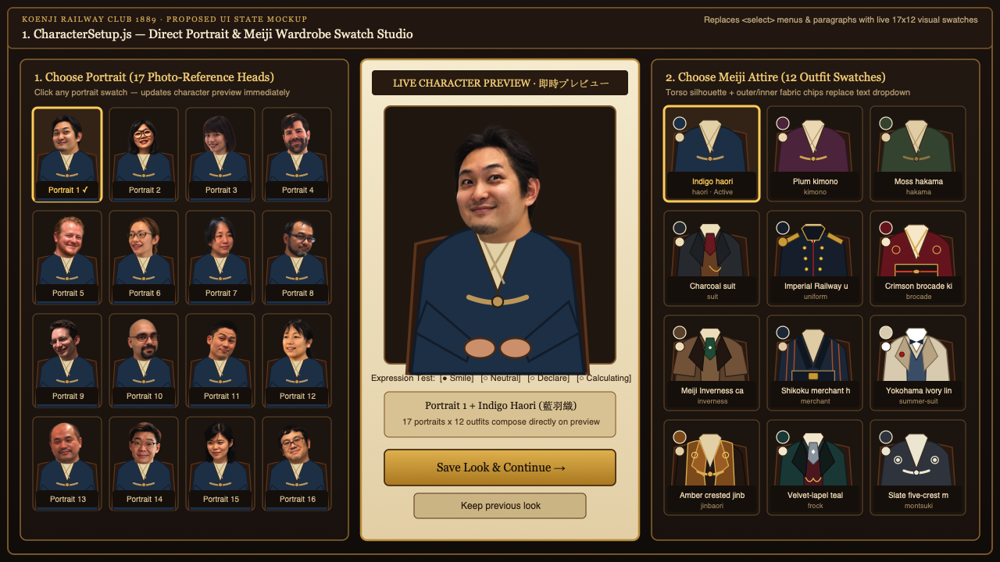
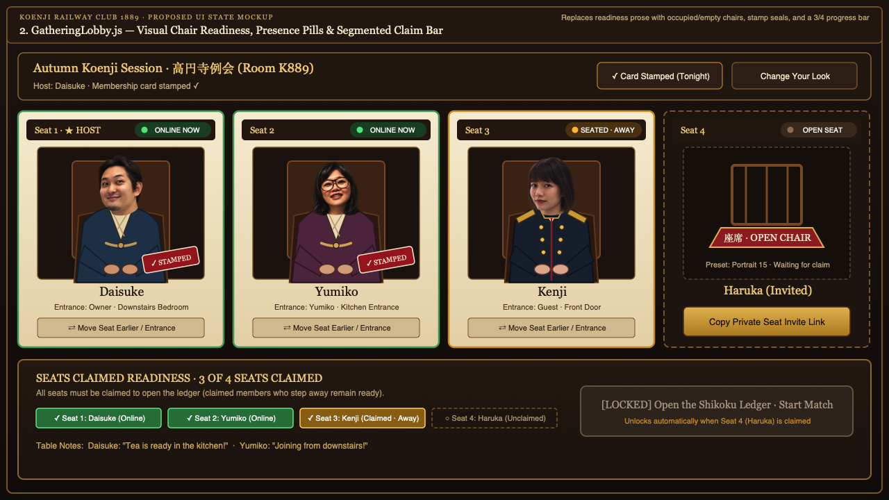
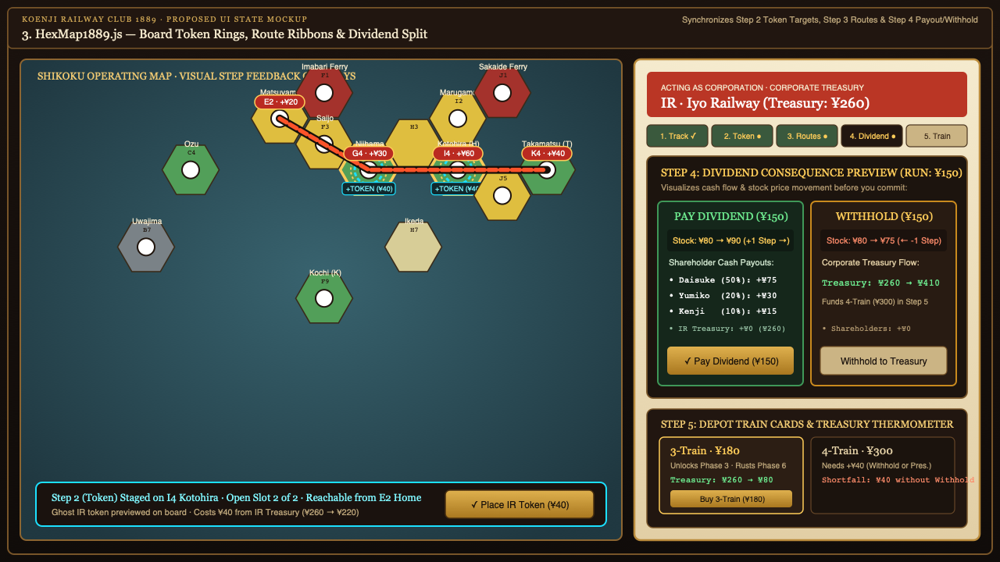
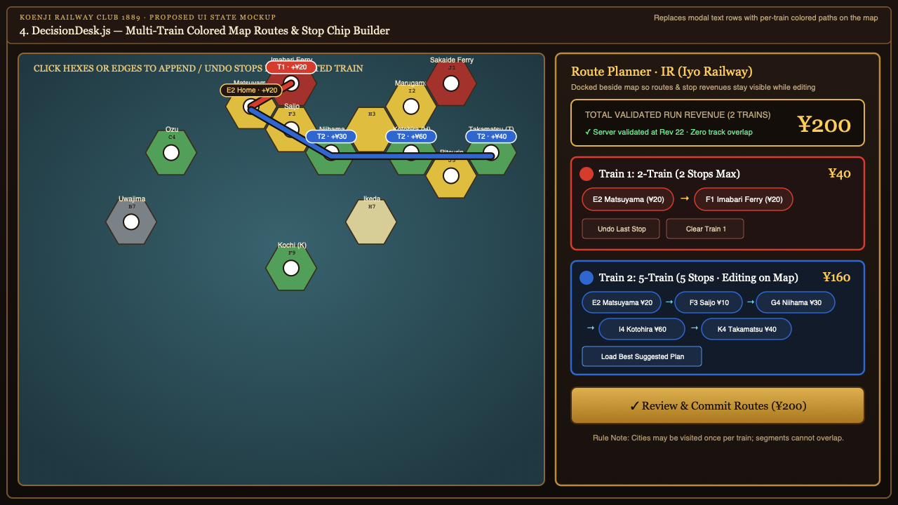
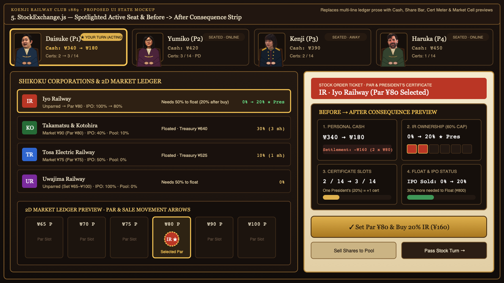
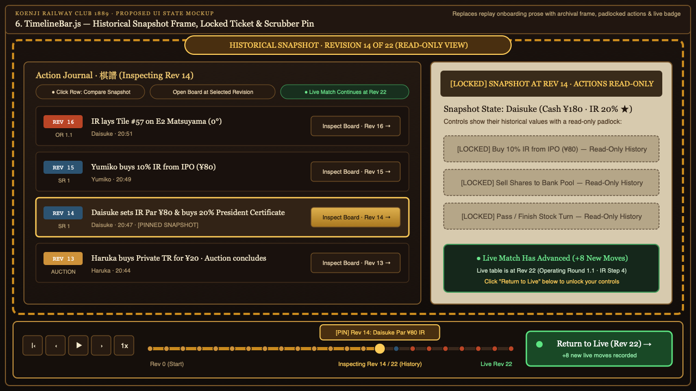

# Koenji Railway Club 1889 — Visual State & "Show, Don't Tell" Refactoring Plan

**Prepared:** 17 October 2026  
**Target Package:** `/Users/jmahmood/Downloads/Koenji_1889_Codex_Starter_Package/koenji-1889`  
**Scope:** [`CharacterSetup.js`](../../src/components/CharacterSetup.js), [`GatheringLobby.js`](../../src/components/GatheringLobby.js), [`HexMap1889.js`](../../src/components/HexMap1889.js), [`DecisionDesk.js`](../../src/components/DecisionDesk.js), [`StockExchange.js`](../../src/components/StockExchange.js), [`TimelineBar.js`](../../src/replay/TimelineBar.js), and [`style.css`](../../src/style.css).  
**Proposed Screenshot Gallery:** [Open Interactive HTML Gallery](visual_state_proposed_screenshots.html)

**Governing Rule:** Keep words for names, numbers, rules, and exceptions. When the UI communicates **who is active**, **what changed**, **what is selectable**, or **what an action will do**, carry that state visually through the existing portraits, certificates, seats, map geometry, and timeline controls while preserving existing DOM/test contracts.

## Proposed Screenshots Index

1. **Character Setup (`CharacterSetup.js`):** [proposed-1-character-setup.png](validation/proposed-1-character-setup.png) ([SVG](validation/proposed-1-character-setup.svg))
2. **Gathering Lobby (`GatheringLobby.js`):** [proposed-2-gathering-lobby.png](validation/proposed-2-gathering-lobby.png) ([SVG](validation/proposed-2-gathering-lobby.svg))
3. **Operating Map & Ticket (`HexMap1889.js`):** [proposed-3-operating-map-ticket.png](validation/proposed-3-operating-map-ticket.png) ([SVG](validation/proposed-3-operating-map-ticket.svg))
4. **Route Planning on Map (`DecisionDesk.js` + `HexMap1889.js`):** [proposed-4-route-planning-map.png](validation/proposed-4-route-planning-map.png) ([SVG](validation/proposed-4-route-planning-map.svg))
5. **Stock & Auction Consequence Preview (`StockExchange.js`):** [proposed-5-stock-auction-preview.png](validation/proposed-5-stock-auction-preview.png) ([SVG](validation/proposed-5-stock-auction-preview.svg))
6. **Timeline Replay & Historical Snapshot (`TimelineBar.js`):** [proposed-6-timeline-historical.png](validation/proposed-6-timeline-historical.png) ([SVG](validation/proposed-6-timeline-historical.svg))

## Executive Summary & Architecture Overview

| # | Component | Current "Tell" Bottleneck | Proposed Visual State Solution | Test & State Contracts Preserved |
|---|---|---|---|---|
| **1** | [`CharacterSetup.js`](../../src/components/CharacterSetup.js) | Native `<select>` dropdowns and two paragraphs explaining that portraits are photo-references and compatible with every Meiji outfit. | Three-column visual studio: clickable 17-portrait swatch grid (`surface: "portrait"`) on the left, large central live paper-doll preview (`renderCharacter`), and 12-item Meiji outfit swatch grid (rendered via `renderTorso` + fabric color chips) on the right. | Preserves `data-save-look`, `data-cancel-look`, `data-look-choice` (or synchronized hidden `<select>` / radio inputs so `form.elements.face.value` and `option value="reference-17"` / `Charcoal suit</option>` tests pass). |
| **2** | [`GatheringLobby.js`](../../src/components/GatheringLobby.js) | Readiness, seat-count rules, and invitation instructions appear as paragraphs (`Seat X · Seated & online now`, `X/Y seats claimed...`). | Visual chair cards (occupied character sprite vs. empty zabuton cushion `座席` with inline copy-invite action), live status pills (`● Online`, `◐ Seated · Away`, `○ Open Seat`), and a segmented brass `Seats Claimed` progress bar integrated into the `data-start-gathering` lock state. | Preserves `.waiting-chairs`, `.host-badge`, `data-start-gathering`, `data-reorder-seat`, `data-resident-route`, `data-waiting-stamp`, and `renderInvitationList`. |
| **3** | [`HexMap1889.js`](../../src/components/HexMap1889.js) | Stepper + `.op-guidance-box` (`WHAT TO DO NOW`) explain steps in prose, while only Step 1 (`track`) has rich board feedback. | Step-aware SVG overlays on the 52-hex board: pulsing token-slot target rings on legal cities in Step 2 (`token`), directional animated route ribbons with stop revenue pills in Step 3 (`routes`), and a visual Dividend Split preview card in Step 4 (`dividend`) showing per-player payouts + stock-step arrows (`+1 →` vs `← -1`) alongside Step 5 depot train cards. | Preserves `data-op-action`, `data-select-hex`, `data-inspect-city`, `role="button"`, `aria-label`, and `mapActionAuthority` checks in [`room_usability.test.mjs`](../../tests/room_usability.test.mjs). |
| **4** | [`DecisionDesk.js`](../../src/components/DecisionDesk.js) | `routePlanner()` is a modal text form (`train: E2 → F3`, `<select data-route-segment>`) disconnected from the map. | Docked/translucent map-linked Route Planner mode: assigns each train a distinct color token (`#e0533c`, `#3b7dd8`, `#2ca568`, `#d49b27`), draws suggested (`view.route_quote`) and drafted (`app.routeDraft`) paths directly on `HexMap1889.js` with per-stop revenue badges, and lets clicks on map hexes/edges append/undo segments visually. | Preserves `data-copy-route-plan`, `data-route-train`, `data-route-segment`, `data-add-route-segment`, `data-preview-routes`, and `data-review-action` in [`decision_desk.test.mjs`](../../tests/decision_desk.test.mjs). |
| **5** | [`StockExchange.js`](../../src/components/StockExchange.js) | `.auction-commitment` (lines 474–485) and `.ticket-ledger` / `.ticket-status-msg` (lines 1335–1435) explain turn ownership, escrow, affordability, and stock deltas in prose. | Spotlighted active seat card (`is-active-seat`) + compact visual **Before → After Consequence Strip** right above the CTA buttons: Cash pill (`¥340 → ¥180`), Escrow bar (`¥0 → +¥35`), Certificate Slot meter (`2/14 → 3/14`), Ownership bar (`0% → 20% ★`), and a mini 2D Market Cell preview showing par/sale price movement. | Preserves `getAuctionContext`, `data-auction-action`, `data-action="buy_shares"`, `data-action="sell_shares"`, and exact text strings asserted in [`room_usability.test.mjs`](../../tests/room_usability.test.mjs) (`One President's (20%)`, `2 / 14 limit → 3`, `Current Player:`). |
| **6** | [`TimelineBar.js`](../../src/replay/TimelineBar.js) | `.journal-intro` paragraph explains how to select/inspect a move and that history is read-only. | Self-demonstrating timeline & board snapshot mode: sepia/amber viewport frame (`is-historical-snapshot`), pinned camera badge on the active scrubber node (`Rev X`), disabled/padlocked ticket buttons, and a live pulse pill on `Return to Live (Rev Y · +N new)`. | Preserves `data-revision`, `data-inspect-revision`, `data-action="live"`, and `renderHistoryJournalView` contracts. |

## 1. Character Setup: Make the Preview and Swatches the Primary Control

### Current Code Bottleneck
In [`CharacterSetup.js:3-12`](../../src/components/CharacterSetup.js), `renderCharacterSetup` renders two native `<select>` elements (`#look-face` and `#look-clothes`) and two paragraphs:
- `"Choose your face and Meiji-inspired clothes before entering."`
- `"Remembered in this browser. Choose one of the photo-reference portraits. Every face works with the Meiji-inspired outfits."`

Because the options are hidden inside dropdown menus, the user has to read about the photo-reference portraits and Meiji outfits instead of seeing them side-by-side and watching the central paper-doll preview compose them immediately.

### Implementation Plan
1. **Replace Dropdowns with Visual Swatch Grids (`src/components/CharacterSetup.js`)**:
   - **Left Column — Portrait Gallery (`.look-face-grid`)**: Map over `APPEARANCE_CATALOG.faces` (17 reference portraits) and render clickable `<button type="button" class="look-swatch face-swatch ${a.face === f.id ? 'is-selected' : ''}" data-pick-face="${f.id}" aria-pressed="${a.face === f.id}">` cards. Inside each swatch, render the head thumbnail using `renderCharacter({ face: f.id, clothes: a.clothes }, { name: f.name, surface: 'portrait' })` and a compact label (`Portrait 1`, `Portrait 2`, etc., with full description in `title`/`aria-label`).
   - **Center Column — Hero Paper-Doll Stage (`.look-preview-stage`)**: Enlarge `.look-preview` so `renderCharacter(a, { name: 'Your character', surface: 'table' })` acts as the visual focal point, flanked by active selection badges (`${activeFace.name} + ${activeClothes.name}`) and a pose/expression preview toggle (`Idle` / `Smile` / `Declare`) so the player sees the paper-doll rig in action.
   - **Right Column — Meiji Wardrobe Rack (`.look-clothes-grid`)**: Map over `APPEARANCE_CATALOG.clothes` (12 outfits) and render clickable `<button type="button" class="look-swatch clothes-swatch ${a.clothes === c.id ? 'is-selected' : ''}" data-pick-clothes="${c.id}" aria-pressed="${a.clothes === c.id}">` cards containing a torso-only SVG preview (`renderTorso(c.id, 'idle')` inside `<svg viewBox="35 95 130 120">`), dual fabric color chips (`style="--outer:${c.color};--inner:${c.inner}"`), and the garment name (`c.name`).
2. **Preserve Form & Automated Test Compatibility (`src/components/CharacterSetup.js` & `src/main.js`)**:
   - Keep the `<select id="look-face" name="face" data-look-choice class="sr-only-select">` and `<select id="look-clothes" name="clothes" data-look-choice class="sr-only-select">` synchronized in the DOM so existing tests in [`invitation_portraits.test.mjs`](../../tests/invitation_portraits.test.mjs) (`option value="reference-17"`) and [`character_arrivals.test.mjs`](../../tests/character_arrivals.test.mjs) (`Charcoal suit</option>`) pass without modification.
   - In [`main.js:1184`](../../src/main.js), bind click handlers on `[data-pick-face]` and `[data-pick-clothes]` that update `appState.appearanceDraft`, sync the `<select>` values, and re-render `.look-preview` immediately.
3. **Trim Redundant Prose**:
   - Remove `"Choose one of the photo-reference portraits. Every face works with the Meiji-inspired outfits."`—the 17×12 visual grid makes universal compatibility self-evident.

## 2. Gathering Lobby: Show Readiness Through the Chairs and Progress Bar

### Current Code Bottleneck
In [`GatheringLobby.js:12-15`](../../src/components/GatheringLobby.js):
- Each seat card prints a text sentence: `
Seat ${s.seat_index+1} · ${s.claimed ? s.online?'Seated & online now':'Seated · away' : 'Seat open · waiting for member'}
`.
- Host controls explain readiness in two prose paragraphs: `
${view.seats.filter(s=>s.claimed).length}/${view.max_players} seats claimed. All seats must be claimed; players need not all be online.

Share each seat invitation privately. Names can be updated before opening the ledger.
`.

### Implementation Plan
1. **Stateful Chair Visuals in `.waiting-chairs` (`src/components/GatheringLobby.js`)**:
   - Give each `<article class="waiting-chair-card">` an explicit state class: `is-claimed is-online`, `is-claimed is-away`, or `is-open-seat`.
   - **Occupied Chairs (`s.claimed`)**: Render the member's paper-doll sprite seated on a wooden club chair (`renderCharacter(...)`), overlaid with:
     - A top-right **Presence Pill**: `<i class="presence-dot"></i>${s.online ? 'Online' : 'Seated · Away'}`.
     - A bottom-right **Membership Stamp Seal** (`✓ Stamped`) when `view.club.stamps[s.player_id]` is true, visually connecting the stamp action to the player's chair.
   - **Empty Chairs (`!s.claimed`)**: Render an illustrated empty wooden chair with the red zabuton cushion (`
座席
`) in a dashed frame, and place a direct action inside the empty chair card for the host: `<button type="button" class="chair-invite-btn" data-copy-seat-invite="${s.seat_index}">Copy Private Seat Invite Link</button>`.
2. **Segmented "Seats Claimed" Progress Bar & Lock State (`src/components/GatheringLobby.js`)**:
   - Replace the host paragraph explaining `X/Y seats claimed` with a visual **Readiness Header Bar** right above `[data-start-gathering]` showing one segment per seat (`seg-online`, `seg-claimed`, `seg-open`) and an explicit lock/unlock state on `Open the Shikoku Ledger · Start Match`.

## 3. Operating Map & Order Ticket: Synchronize Every Step on the Board

### Current Code Bottleneck
In [`HexMap1889.js:1940-2415`](../../src/components/HexMap1889.js):
- Step 1 (`track`) highlights `.is-buildable` hexes with a dashed gold border and renders a live SVG tile preview (`tilePreview`) plus `.map-floating-lay-bar`.
- Steps 2 (`token`), 3 (`routes`), 4 (`dividend`), and 5 (`train`) rely heavily on `.op-guidance-box` text (`WHAT TO DO NOW`) and right-hand ticket buttons, with minimal board-level visual affordances.

### Implementation Plan
1. **Step 2 (`token`) — Legal Token Slot Target Rings & Ghost Token Preview (`src/components/HexMap1889.js`)**:
   - Compute `legalTokenHexes`: all hexes where `isActiveActor && legalTypes.includes('place_token')` and `coord` is reachable via `computeReachableVerticesClient(state.board, activeCorpId)`, has an open city slot (`(hexObj.tokens?.[idx]?.length || 0) < (node.slots || 1)`), and does not already contain `activeCorpId`.
   - Render a pulsing SVG station ring (`<circle class="token-slot-target-ring" cx="${pt.x}" cy="${pt.y}" r="18" />`) directly over open city slots on reachable hexes, with a `+TOKEN (¥40)` tag and a translucent ghost token preview when selected.
2. **Step 3 (`routes`) — Directional Route Ribbons & Per-Stop Revenue Badges on the Map**:
   - Add a top-level `<g class="map-route-overlay-layer">` in the Shikoku SVG (`HexMap1889.js:2165`) so routes are drawn above hex borders with per-train color coding and stop callouts (`+¥20`, `+¥30`, `+¥60`) on each visited city/town/offboard vertex.
3. **Step 4 (`dividend`) — Visual Dividend Consequence Split Card & Stock Movement Preview**:
   - In `HexMap1889.js:2357-2369`, replace the plain two-button `.dividend-split` with a side-by-side **Consequence Comparison Card**:
     - **Left Option — `Pay Dividend (${money(rev)})`**: Shows shareholder cash payouts (`Daisuke +¥75`, `Yumiko +¥30`) and a green stock-price movement pill (`Stock: ¥80 → ¥90 (+1 Step →)`).
     - **Right Option — `Withhold (${money(rev)})`**: Shows a treasury arrow (`Treasury: ¥260 → ¥410`) and an amber stock-price movement pill (`Stock: ¥80 → ¥75 (← -1 Step)`).
4. **Step 5 (`train`) — Visual Depot Train Cards & Treasury Thermometer**:
   - Upgrade `.train-buy-box` (`HexMap1889.js:2372-2385`) to show compact visual train cards with phase/rust tags and post-purchase treasury balances.

## 4. Route Planning: Draw Multi-Train Paths Directly on the Map

### Current Code Bottleneck
In [`DecisionDesk.js:49-65`](../../src/components/DecisionDesk.js), `routePlanner()` opens inside a centered modal dialog that covers the board. Suggested routes appear as text lines (`2-0: E2:n0 → F3:n0`), and custom route building requires picking raw hex/path indices (`<option value="E2:0">E2 · path 1 (e0 ↔ n0)</option>`) from a `<select>` dropdown.

### Implementation Plan
1. **Per-Train Color Palette & Shared Route Overlay (`src/constants1889.js`, `src/components/HexMap1889.js`)**:
   - Define `TRAIN_ROUTE_COLORS = ['#e0533c', '#3b7dd8', '#2ca568', '#d49b27', '#9b59b6']` so Train 1, Train 2, Train 3, etc., always receive distinct, high-contrast rail colors on both the map and the planner UI.
   - In the SVG `<g class="map-route-overlay-layer">`, trace each train's path across hexes with an offset parallel stroke when multiple trains share a track segment and floating revenue pills (`T1 · +¥20`, `T2 · +¥60`) over every scored node.
2. **Map-Integrated Route Planner Dock (`src/components/DecisionDesk.js` & `src/components/HexMap1889.js`)**:
   - Dock the Route Planner alongside the Map view so the full Shikoku SVG map remains visible and clickable while building or reviewing routes.
   - Render each train's route as a horizontal chain of station chips (`[E2 Matsuyama ¥20] → [F3 Saijo ¥10] → [G4 Niihama ¥30]`) instead of raw vertex IDs (`E2:n0`), and let clicks on connected map hexes append/undo segments while keeping `<select data-route-train>`, `<select data-route-segment>`, and `[data-add-route-segment]` synchronized for [`decision_desk.test.mjs`](../../tests/decision_desk.test.mjs).

## 5. Auction & Stock Controls: Compact Before/After Consequence Previews

### Current Code Bottleneck
- In [`StockExchange.js:474-485`](../../src/components/StockExchange.js), `.auction-commitment` uses 4–5 lines of paragraph text to explain what is on offer, what is being inspected, available cash, escrow, additional commitment, whose turn it is, and bid increments.
- In [`StockExchange.js:1335-1435`](../../src/components/StockExchange.js), the stock order ticket repeats similar facts across `.ticket-ledger`, `.order-total`, `.settlement-summary`, and `.ticket-status-msg` paragraphs.

### Implementation Plan
1. **Active Seat Spotlight & Turn Ownership Badge (`src/components/StockExchange.js`)**:
   - Elevate `.active` player card in `renderAuctionPlayerStrip` and `renderUnifiedPlayerAndTurnStrip` with a gold spotlight frame and clear `★ YOUR TURN (ACTING)` badge.
2. **Compact Visual Before → After Consequence Strip (Auction & Stock Tickets)**:
   - Replace repetitive prose in `.auction-commitment` and `.settlement-summary` with a unified **4-Metric Before/After Consequence Grid** (`.consequence-preview-grid`) positioned immediately above the primary action buttons:
     - **Metric 1 — Personal Cash**: `¥340 → ¥180` (`Settlement: -¥160`).
     - **Metric 2 — Escrow / Share Holdings**: 6-segment ownership bar (`10%` per box up to the `60%` limit, marking `20% ★ Pres`).
     - **Metric 3 — Certificate Slots**: Visual slot meter `2 / 14 → 3 / 14`.
     - **Metric 4 — Float & Market Cell Preview**: Progress bar toward 50% float and mini 2D Market Cell preview showing the Par slot (`¥80 P`) or downward sale price shift.

## 6. Timeline & Replay Onboarding: Let the Timeline Demonstrate Itself

### Current Code Bottleneck
In [`TimelineBar.js:118-120`](../../src/replay/TimelineBar.js), `renderHistoryJournalView` displays an onboarding paragraph:
> *"Select a move to compare its snapshot with the surrounding entries. Choose Inspect resulting position to open its board or financial desk. Historical game positions are read-only; the live match continues independently."*

### Implementation Plan
1. **Visual Snapshot Marker & Event Nodes on the Scrubber (`src/replay/TimelineBar.js`)**:
   - Color-code `.timeline-line` event ticks by round type (Auction = brass `#d8a24a`, Stock = teal `#396684`, Operating = vermilion `#c85a32`) and place a raised **Snapshot Pin** (`[PIN] Rev X`) above the currently inspected `viewRev` node.
2. **Self-Demonstrating "Historical View" Board Treatment (`src/main.js`, `src/style.css`, `src/replay/TimelineBar.js`)**:
   - Toggle `.is-historical-mode` on `.app-shell` when `viewRevision !== liveRevision`, applying a dashed archival gold/sepia border frame around the workspace, a top ribbon badge (`HISTORICAL SNAPSHOT · REVISION X OF Y (READ-ONLY VIEW)`), padlocked ticket action buttons (`[LOCKED]`), and a glowing green `Return to Live (Rev Y · +N new moves) →` button.
3. **Replace `.journal-intro` Paragraph with Compact Visual Legend Chips (`src/replay/TimelineBar.js`)**:
   - Replace the 3-sentence `.journal-intro` paragraph in `renderHistoryJournalView` with three scannable chips: `[● Click Row: Compare Snapshot]`, `[Open Board at Selected Revision]`, and `[● Live Match Continues at Rev Y]`.
