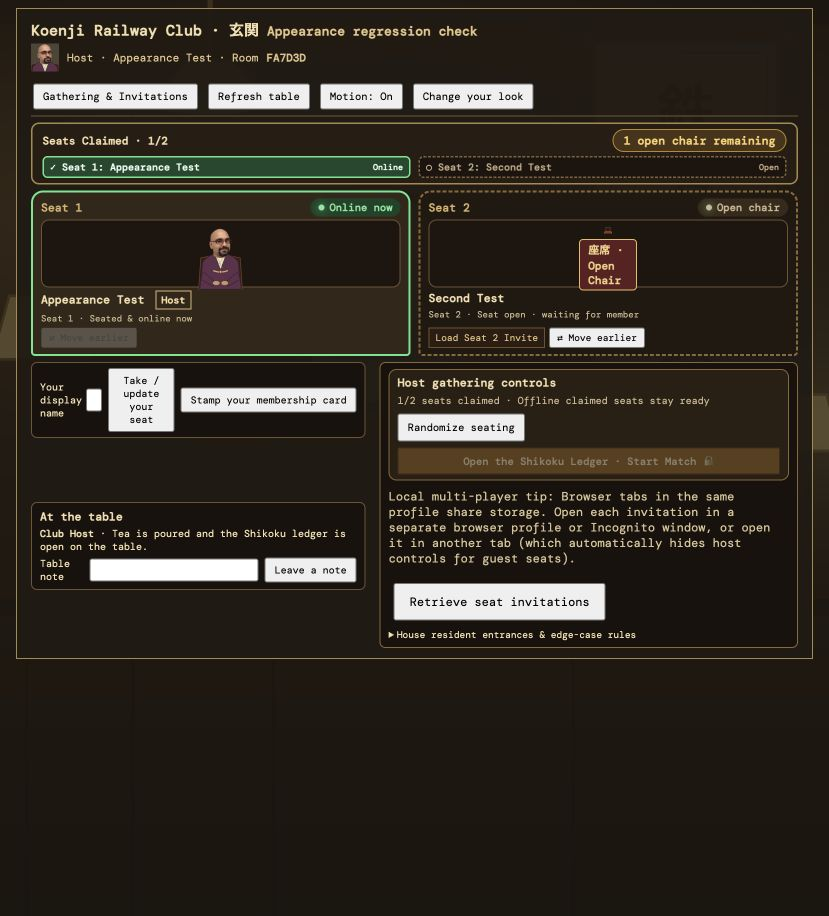

# HTTP LAN appearance-save regression

## Cause

`KoenjiApiClient.arrive()` calls `getBrowserId()` before sending the appearance
request. New browser profiles on HTTP LAN origins do not expose the
secure-context-only `crypto.randomUUID()` API. Its unconditional invocation threw
before POST /arrival, leaving the server's default appearance in the waiting-room
host portrait and seat. Localhost development did not expose this problem.

The fallback now generates a 128-bit hex browser identifier with
`crypto.getRandomValues()`, which is available on HTTP origins. Existing persisted
browser IDs and the HTTPS randomUUID path are retained. No server/schema changes
were required.

References:
- https://developer.mozilla.org/en-US/docs/Web/API/Crypto/randomUUID
- https://developer.mozilla.org/en-US/docs/Web/API/Crypto/getRandomValues

## Reproduction and verification

A separate two-player room, titled “Appearance regression check”, was created
through the deployed UI at http://10.0.0.30:8080. Before the fix, choosing Portrait 5
and Charcoal suit resulted in the default Portrait 1 and Indigo haori in the
waiting room. The user's gathering was not modified.

After deploying the new frontend bundle:
- Reloading the same test room displayed Portrait 5 and Charcoal suit.
- Changing to Portrait 10 and Plum kimono updated both host and seat portraits.
- A full page reload retained Portrait 10 and Plum kimono.
- The production build passed, with the existing Vite bundle-size advisory.
- All 97 JavaScript tests passed, including the new HTTP arrival regression.
- The seven backend character-arrival tests and three character-event tests passed.
- The broader npm test run was stopped during its long full-game replay; it did
  not complete the remaining backend/engine suite.
- The selected face/outfit were also verified directly in the Pi test-room
  database record, independently of browser storage.
- `git diff --check` passed.

The new test removes randomUUID while retaining getRandomValues and checks that
appearance POSTs reach the service with the selected face/outfit, a stable browser
ID across instances, independent IDs in separate storage, and observer-compatible
ID syntax.

## Deployment

The new bundle is `assets/index-BceA3DnE.js`. The previous bundle was retained,
and the prior HTML entry point was saved as
`/home/jawaad/koenji/www/index.html.before-appearance-fix` on the Pi. The entry point
was replaced atomically. The live database was backed up before deployment; no
backend restart or game migration was necessary.
